<div align="center">


# Senvu — Customer Intelligence & AI Evals

### Turn customer feedback into product decisions — and evaluate whether the AI producing those decisions can be trusted.

[](https://nextjs.org/)
[](https://www.typescriptlang.org/)
[](https://www.python.org/)
[](https://supabase.com/)
[](https://www.netlify.com/)

**Live application:** https://senvu-customer-intelligence-ai-evals.netlify.app  

</div>

---

## Table of contents

- [What is Senvu?](#what-is-senvu)
- [The problem](#the-problem)
- [Project at a glance](#project-at-a-glance)
- [30-second reviewer tour](#30-second-reviewer-tour)
- [Product experience](#product-experience)
- [Customer-intelligence logic](#customer-intelligence-logic)
- [Evidence and recommendations](#evidence-and-recommendations)
- [Database design](#database-design)
- [Data ingestion logic](#data-ingestion-logic)
- [Sentiment analysis logic](#sentiment-analysis-logic)
- [AI evaluation logic](#ai-evaluation-logic)
- [Human-in-the-loop review](#human-in-the-loop-review)
- [Interactive recruiter sandbox](#interactive-recruiter-sandbox)
- [Frontend/data-layer logic](#frontenddata-layer-logic)
- [System architecture](#system-architecture)
- [Security and deployment](#security-and-deployment)
- [Technology stack](#technology-stack)
- [Repository structure](#repository-structure)
- [Run locally](#run-locally)
- [Engineering decisions](#engineering-decisions)
- [Project evolution](#project-evolution)
- [Limitations and future work](#limitations-and-future-work)

---

# What is Senvu?

Senvu is a full-stack **Customer Intelligence + AI Evaluation** platform built around two related questions:

1. **What are customers telling us about our products?**
2. **How much should we trust the AI/NLP system interpreting that feedback?**

The platform combines customer-feedback analytics with model evaluation in one workflow. It ingests customer feedback, normalizes it, stores it in PostgreSQL through Supabase, runs sentiment analysis, surfaces customer themes and problems, links insights back to supporting reviews, supports human correction, and evaluates NLP/model quality against a repeatable test suite.

Senvu can:

- ingest and normalize customer feedback
- associate feedback with products and imported datasets
- run sentiment analysis
- compare multiple NLP/model approaches
- surface recurring themes
- identify pain points
- identify feature requests
- detect emerging issues
- link insights back to supporting reviews
- produce evidence-backed recommended actions
- support human corrections and reviewer notes
- evaluate model quality with reusable test cases
- compare classification quality, latency, cost and failure modes
- provide an executive leadership view
- provide a recruiter-safe interactive sandbox

The project began as a smaller customer-feedback ETL pipeline and evolved into a product-style application using Next.js, Supabase/PostgreSQL, Python NLP pipelines, a structured AI evaluation framework, a human-review workflow, and Netlify deployment.

---

# The problem

Companies collect large volumes of feedback from marketplaces, support channels, surveys, app stores and direct customer conversations. The difficult part is not collecting the data; it is turning hundreds or thousands of individual comments into **reliable product decisions**.

A standard dashboard may show average rating or positive sentiment percentage, but that does not answer deeper questions:

- What is causing negative sentiment?
- Which problems recur across products?
- Which product deserves the most attention?
- What capabilities are customers repeatedly requesting?
- Which issues are growing over time?
- Which reviews support an AI-generated conclusion?
- Where does the sentiment model fail?
- Did a model change improve quality or introduce a regression?
- Can a human reviewer correct a prediction without destroying the original output?

Senvu is designed around the complete chain:

```text
RAW CUSTOMER FEEDBACK
        ↓
NORMALIZATION
        ↓
MODEL ANALYSIS
        ↓
CUSTOMER SIGNALS
        ↓
SUPPORTING EVIDENCE
        ↓
RECOMMENDED PRODUCT ACTION
```

while also supporting:

```text
MODEL OUTPUT
        ↓
EVALUATION TEST SUITE
        ↓
QUALITY METRICS
        ↓
FAILURE-MODE ANALYSIS
        ↓
HUMAN REVIEW
        ↓
REGRESSION COMPARISON
```

---

# Project at a glance

| Area | Current portfolio state |
|---|---:|
| Persisted customer reviews | **1,200** |
| Demo organization | **Nova Electronics** |
| Products | **3** |
| Reviews per product | **400** |
| VADER + TextBlob analysis rows | **2,400** |
| Structured evaluation cases | **100** |
| Failure-mode categories | **20** |
| Persisted customer-intelligence records | **50** |
| Interactive sandbox reviews | **75** |
| Database | **Supabase / PostgreSQL** |
| Frontend | **Next.js 15 / React / TypeScript** |
| NLP / analytics | **Python / Pandas / VADER / TextBlob / scikit-learn** |
| Deployment | **GitHub → Netlify + Supabase** |

The demo portfolio contains **NovaWatch**, **NovaPhone X**, and **NovaBuds Pro**.

---

# 30-second reviewer tour

For a hiring manager or reviewer, the fastest path through the project is:

1. Open the live application.
2. Start on **Overview** and change the product/model/date filters.
3. Inspect sentiment and product-health metrics.
4. Open **Products** and compare the portfolio.
5. Drill into an individual product.
6. Open **Reviews** to inspect the raw evidence.
7. Open **Insights** to see themes, pain points, feature requests, trends and recommendations.
8. Open **Model Evaluation** to inspect quality metrics and model comparisons.
9. Open **Human Review** to see the human-in-the-loop workflow.
10. Open **Try Senvu** and run the isolated 75-review sandbox.

---

# Product experience

## 1. Overview — portfolio health in one workspace

The Overview page is the main operating view. It combines total review volume, average rating, sentiment score, positive/negative share, review-volume change, sentiment trends, rating distribution, themes, key takeaways, product comparison, recent reviews, filters, model selection and export actions.

Filters are converted into query parameters so the same state can be reused by the dashboard, executive view and export endpoints.

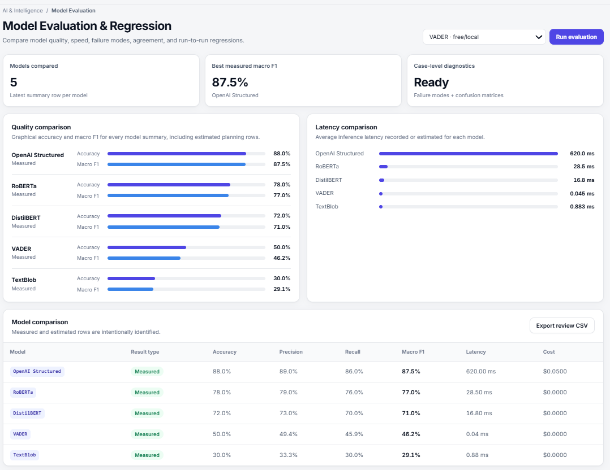

*Overview — customer health, sentiment trends, model selection, filters and portfolio intelligence in one workspace.*

### Sentiment score logic

The dashboard uses a compact sentiment score based conceptually on:

```text
positive share - negative share
```

For example:

```text
53.3% positive - 31.1% negative = +22.2
```

The score is a compact leadership KPI; the underlying positive/neutral/negative distribution remains visible.

---

## 2. Executive View — leadership summary

The Executive View condenses the workspace into a smaller decision-oriented surface with review volume, average rating, sentiment score, positive/negative share, leadership takeaways, sentiment trajectory, sentiment mix and print/PDF support.

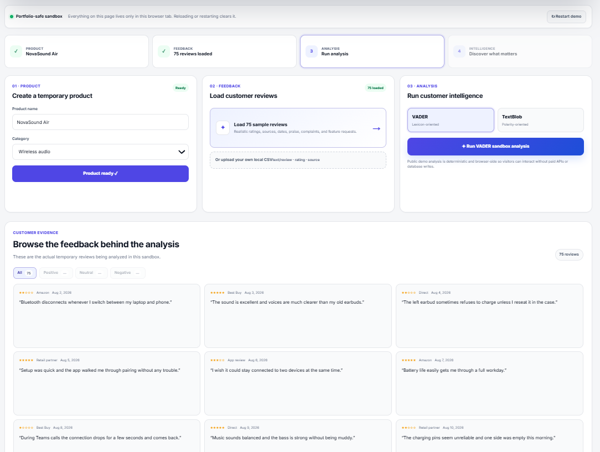

*Executive View — a leadership-focused summary of customer health, sentiment and key takeaways.*

---

## 3. Products — compare the portfolio

The Products page compares review count, average rating, sentiment score and positive share across the portfolio and supports side-by-side comparison.

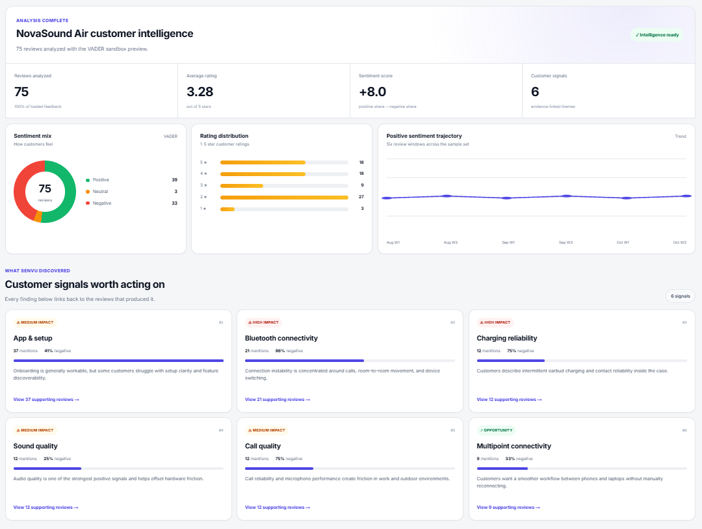

*Products — compare review volume, rating, sentiment and positive share across the product portfolio.*

This makes questions such as “Is the negative sentiment company-wide or isolated to one product?” straightforward to answer.

---

## 4. Product Detail — drill into one product

Each product has a dedicated intelligence view combining product review volume, rating, sentiment score, positive/negative share, trend history, sentiment breakdown, rating distribution and persisted product intelligence.

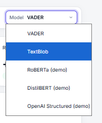

*Product Detail — product-level KPIs, sentiment history, rating distribution and persisted customer intelligence.*

---

## 5. Reviews — the evidence layer

Higher-level insights are only useful if someone can inspect the underlying customer evidence. The Reviews workspace exposes review text, product, rating, sentiment, source, date, search and CSV export.

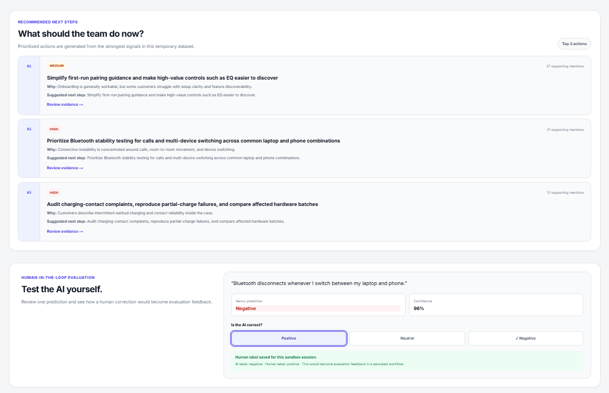

*Reviews — inspect the underlying feedback with product, rating, sentiment, source and date context.*

The evidence chain is:

```text
dashboard metric
      ↓
customer signal
      ↓
supporting review
```

---

# Customer-intelligence logic

## 6. Customer Intelligence — from language to product signals

The Insights workspace turns review text into structured product signals. The current pipeline persists and presents themes, pain points, feature requests, emerging issues and evidence-backed recommendations.

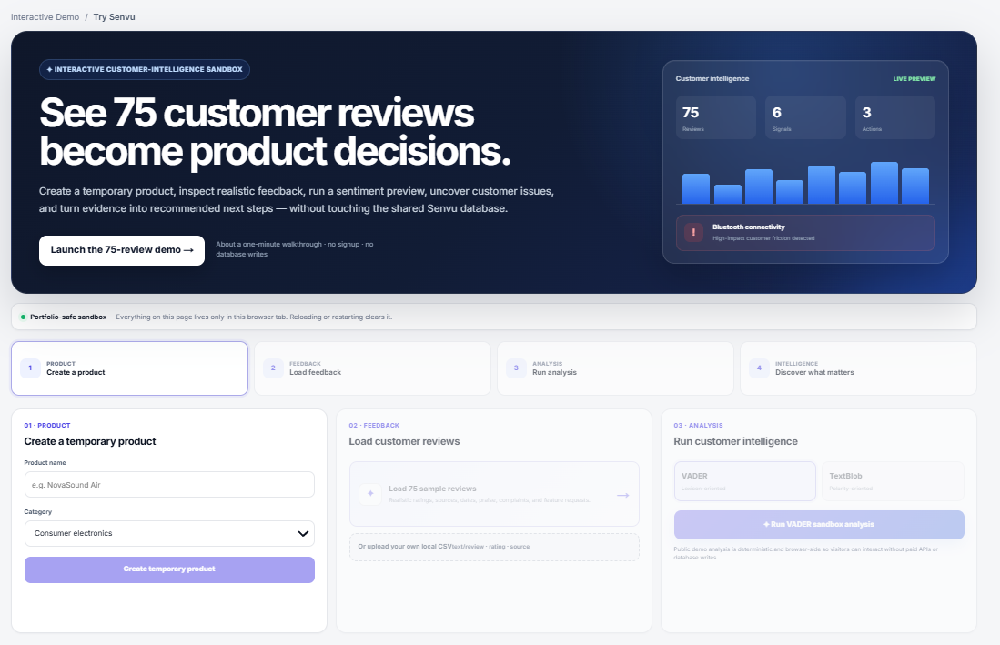

*Customer Intelligence — recurring language patterns are organized into themes, friction, demand, emerging issues and prioritized actions.*

### TF-IDF / n-gram extraction

The customer-intelligence pipeline uses a free-first approach built around scikit-learn TF-IDF and n-gram extraction.

```text
REVIEWS
   ↓
TEXT CLEANING
   ↓
TOKEN / N-GRAM GENERATION
   ↓
TF-IDF WEIGHTING
   ↓
HIGH-VALUE TERMS / PHRASES
   ↓
RULE-BASED SIGNAL CLASSIFICATION
   ↓
CUSTOMER_INSIGHTS
```

TF-IDF helps identify terms that are important to a subset of reviews rather than merely common across the entire corpus.

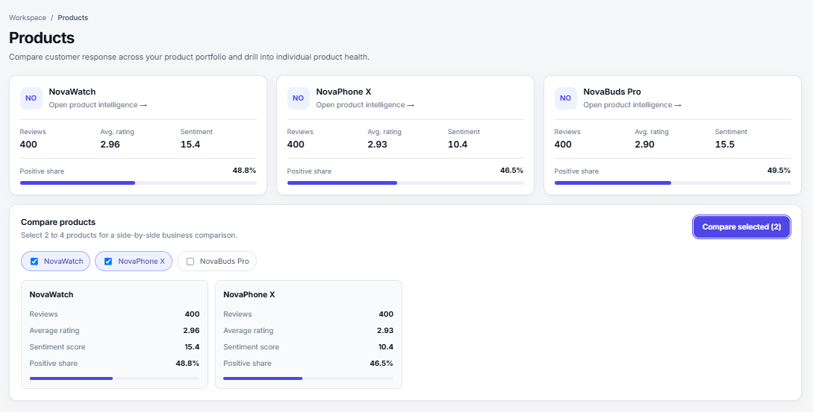

*Top Themes — TF-IDF-derived language patterns are consolidated across products, ranked by mention volume and linked to evidence.*

### Pain points vs feature requests

A pain point represents a repeated customer problem. A feature request represents language suggesting a capability customers want added or improved.


*Customer friction and demand — pain points and feature requests are grouped by mention volume, product coverage, confidence and supporting evidence.*

### Emerging-issue detection

Senvu compares signal rates across review windows to surface movement over time.

```text
previous window rate
        ↓
current window rate
        ↓
period change
```

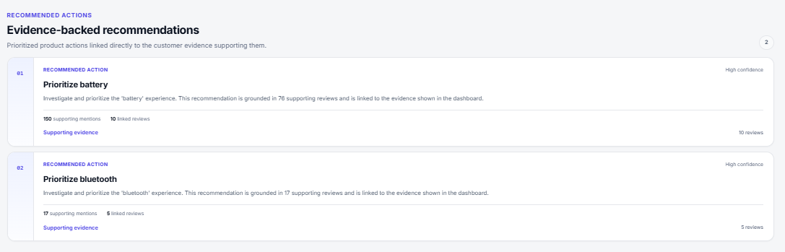

*Emerging Issues — signal movement is compared across review windows to identify topics whose mention rate is changing.*

### Insight consolidation

Persisted intelligence can contain repeated labels across products or runs. Rendering every row directly would create duplicate cards. The UI therefore normalizes titles, creates stable keys, groups equivalent signals, combines product coverage, preserves unique evidence, avoids duplicate counting for the same product and ranks by mention volume.

This is a presentation-layer transformation: the original database rows remain intact.

---

# Evidence and recommendations

A core design principle is that an insight should be inspectable. Instead of only producing “Prioritize battery,” Senvu links an action to the customer signal, mention volume, affected products and supporting reviews.

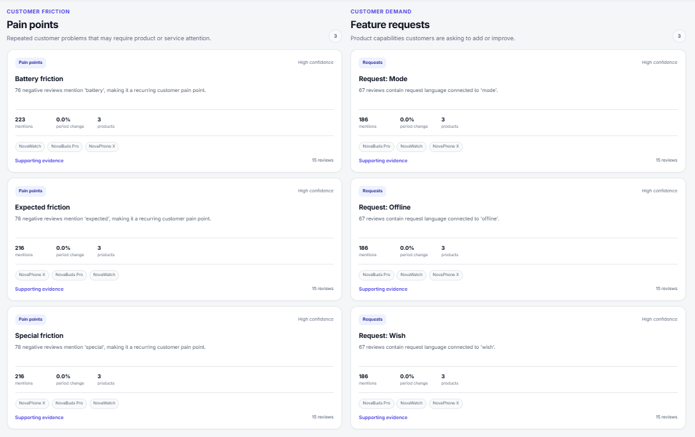

*Evidence-backed recommendations — prioritized actions are linked directly to the feedback supporting them.*

The intended chain is:

```text
CUSTOMER EVIDENCE
       ↓
RECURRING SIGNAL
       ↓
PRODUCT INTERPRETATION
       ↓
RECOMMENDED ACTION
```

---

# Database design

The relational schema separates raw feedback, model output, human judgment and evaluation data.

| Table | Responsibility |
|---|---|
| `organizations` | company/workspace |
| `products` | products owned by an organization |
| `datasets` | imported feedback batches |
| `feedback` | individual customer reviews |
| `analyses` | model/NLP output per review |
| `human_labels` | reviewer corrections and adjudication |
| `eval_test_cases` | reusable evaluation examples |
| `eval_runs` | individual evaluation executions |
| `eval_scores` | evaluation results |
| `customer_insights` | themes, pain points, requests, trends and recommendations |

### Why `analyses` is separate from `feedback`

A single review may be analyzed by several models:

```text
feedback
   |
   +── VADER analysis
   +── TextBlob analysis
   +── RoBERTa analysis
   +── DistilBERT analysis
   +── structured LLM analysis
```

Separating analyses enables multi-model comparison, repeated analysis, version tracking, confidence storage and latency/cost tracking.

### Why human labels are separate

Human review should not overwrite the original AI decision. Senvu preserves **model output** and **human judgment** as separate records so disagreement can later be evaluated.

---

# Data ingestion logic

The ingestion workflow lives under `ai/pipelines/`, with modules such as `ingest.py`, `normalize.py`, `analyze_feedback.py` and `customer_intelligence.py`.

```text
CSV / JSON / JSONL
        ↓
LOAD ROWS
        ↓
VALIDATE
        ↓
NORMALIZE
        ↓
ASSOCIATE PRODUCT + DATASET
        ↓
PERSIST FEEDBACK
        ↓
ANALYZE
```

Normalization handles real-world inconsistencies such as missing fields, inconsistent dates, source names, empty comments, invalid types and rating formats.

### Supabase pagination

During development, the intelligence pipeline initially processed 1,000 reviews even though 1,200 existed. The retrieval logic was updated to fetch feedback in pages using range-based pagination.

Conceptually:

```python
offset = 0
while True:
    rows = fetch(offset, offset + page_size)
    if not rows:
        break
    all_rows.extend(rows)
    offset += page_size
```

After this change, the full intelligence run processed **1,200 reviews across 3 products** and persisted **50 customer-intelligence records**.

---

# Sentiment analysis logic

The model adapters live under `ai/models/` and include VADER, TextBlob, RoBERTa, DistilBERT and a structured LLM adapter.

### VADER

VADER is used as a free local baseline. Its score is mapped into positive, neutral or negative sentiment.

### TextBlob

TextBlob provides a second local baseline. Its polarity output is mapped into the same three-class label space.

The shared output representation makes models comparable:

```text
SAME REVIEW
    ↓
MULTIPLE MODELS
    ↓
COMPARABLE OUTPUT STRUCTURE
    ↓
EVALUATION
```

---

# AI evaluation logic

The evaluation framework lives under `ai/evals/` and includes `rubric.yaml`, `run_evals.py`, `sync_cases.py` and `test_cases.jsonl`.

The current suite contains **100 cases across 20 failure categories**.

```text
TEST CASE
   ↓
EXPECTED OUTPUT
   ↓
MODEL
   ↓
PREDICTION
   ↓
SCORER
   ↓
METRICS + FAILURE CATEGORY
   ↓
EVAL RUN
```

Metrics include accuracy, macro precision, macro recall, macro F1, latency and cost. The design also supports case-level diagnostics, confusion matrices and regression-oriented comparisons.


*Model Evaluation — compare model quality, latency and evaluation summaries in one workspace.*

### Model provenance

The verified executed local baseline metrics in this portfolio build are **VADER and TextBlob**. RoBERTa, DistilBERT and OpenAI Structured are available as product/demo comparison modes, but their public review-level outputs are fixed/preloaded reference data rather than fresh hosted inference generated when a visitor selects them.

The model selector explicitly labels these modes as demo options:

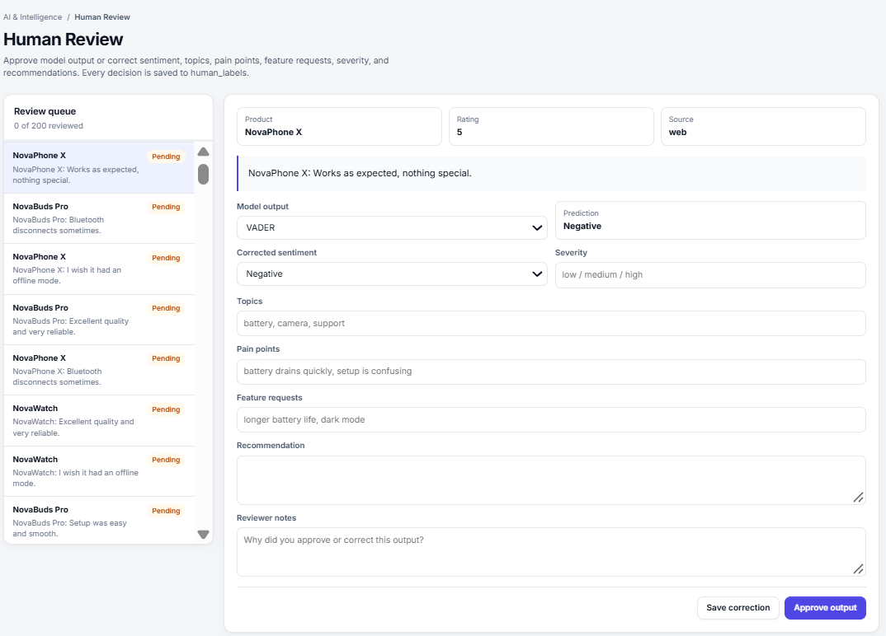

*Model selector — hosted comparison modes are identified as demo modes in the interface.*

### Measured baseline results

| Model | Accuracy | Macro Precision | Macro Recall | Macro F1 | Latest local avg. latency | API cost |
|---|---:|---:|---:|---:|---:|---:|
| **VADER** | **50.0%** | 49.44% | 45.90% | **46.24%** | 0.044 ms | $0 |
| **TextBlob** | **30.0%** | 33.33% | 30.03% | **29.12%** | 0.607 ms | $0 |

The point of the eval suite is not to manufacture a high score; it is to expose failure modes such as negation, mixed sentiment, expectation gaps, comparison language, implicit dissatisfaction and ambiguous phrasing.

---

# Human-in-the-loop review

Senvu includes a review queue where a human can inspect model output and approve or correct it.

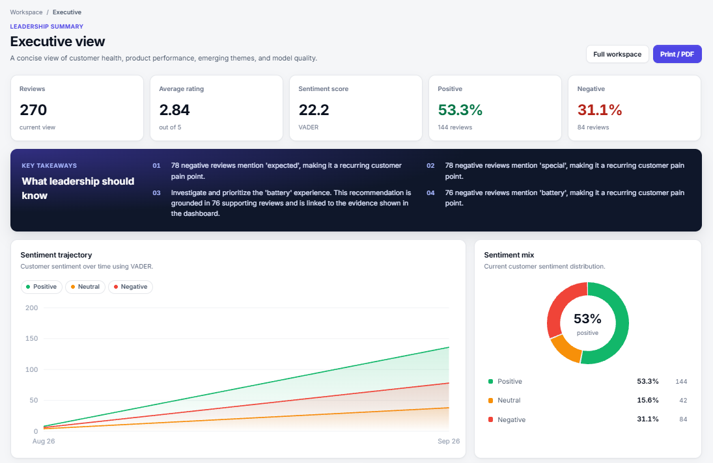

*Human Review — inspect a prediction, correct structured fields, add reviewer notes and preserve human judgment separately from model output.*

The workflow supports review context, selected model, predicted sentiment, corrected sentiment, severity, topics, pain points, feature requests, recommendation, reviewer notes and approval/correction.

```text
MODEL PREDICTION
       ↓
HUMAN REVIEW
       ↓
APPROVE OR CORRECT
       ↓
HUMAN LABEL
       ↓
FUTURE EVALUATION / ERROR ANALYSIS
```

---

# Interactive recruiter sandbox

A public portfolio should allow interaction without letting visitors pollute the shared database. Senvu solves this with an isolated `/demo` experience.

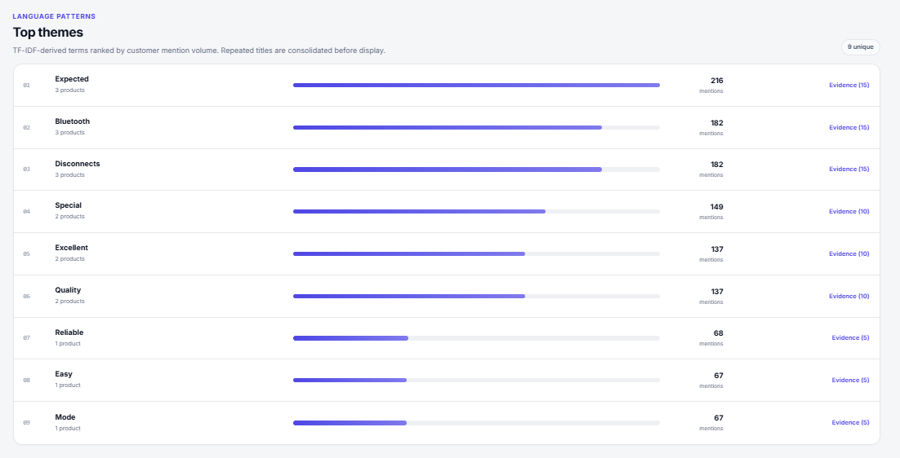

*Interactive sandbox — create a temporary product, load sample feedback and run a customer-intelligence preview without touching the shared database.*

The demo flow is:

```text
1. PRODUCT
      ↓
2. FEEDBACK
      ↓
3. ANALYSIS
      ↓
4. INTELLIGENCE
```

### 75-review browser

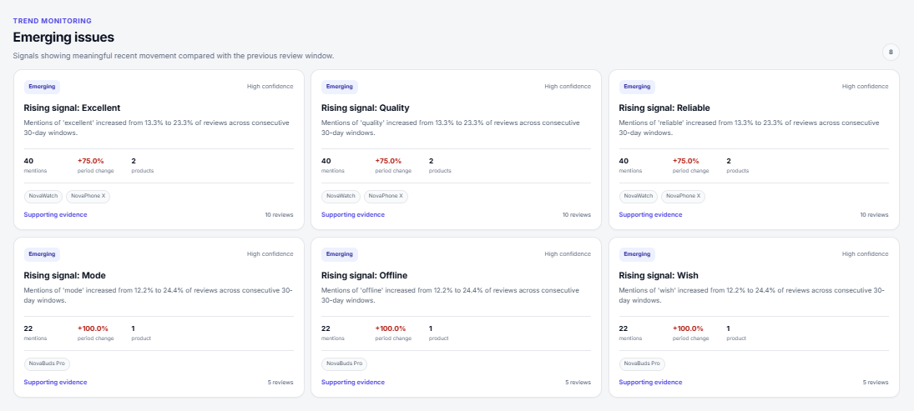

*Demo review browser — 75 realistic temporary reviews are visible before analysis, including rating, source, date and text.*

The public demo performs **zero Supabase writes** for its temporary state. Reloading/restarting clears the session so one recruiter never affects the next recruiter.

### Demo analysis

The sandbox analysis is a deterministic browser-side product preview. It does not claim that Python VADER/TextBlob packages or a paid hosted API are executing inside the visitor's browser.

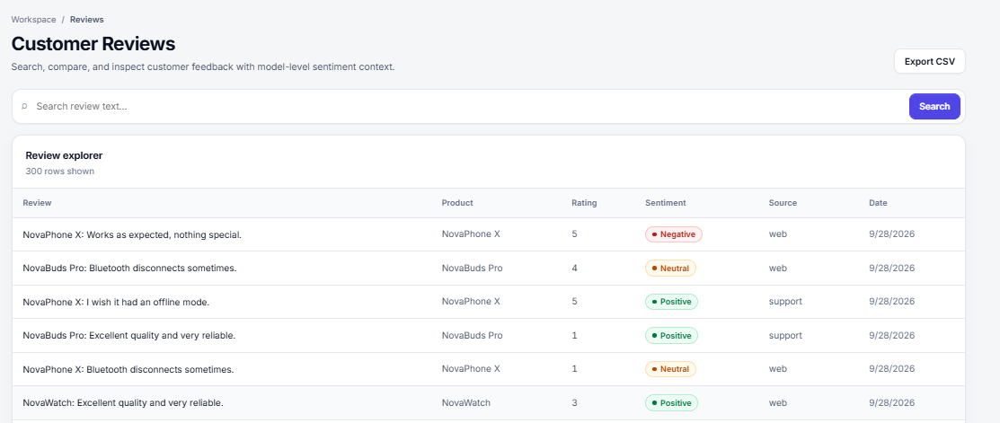

*Demo analysis — 75 reviews become sentiment metrics, rating patterns, trend signals and evidence-linked customer issues.*

The demo surfaces review count, average rating, sentiment score, sentiment mix, rating distribution, positive-sentiment trajectory, customer-signal count and supporting-review links.

### From insight to action

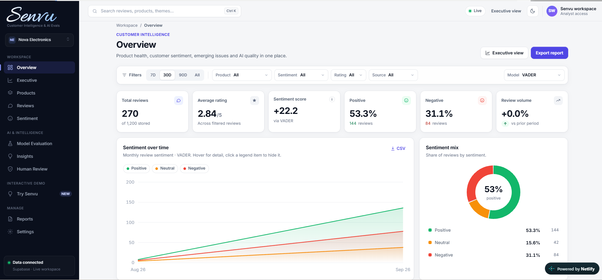

*Recommended next steps — the strongest customer signals are translated into actionable product recommendations, with a lightweight human-review interaction below.*

The product story is:

```text
CUSTOMER EVIDENCE
       ↓
SIGNAL
       ↓
INTERPRETATION
       ↓
RECOMMENDED NEXT STEP
```

---

# Frontend/data-layer logic

The main frontend data transformation lives in `web/lib/data.ts`.

```text
SUPABASE
   ↓
FETCH FEEDBACK + RELATED ANALYSES
   ↓
FILTER
   ↓
SELECT MODEL OUTPUT
   ↓
AGGREGATE
   ↓
PAGE DATA
   ↓
REACT COMPONENTS
```

The data layer computes filtered review counts, average rating, sentiment totals, sentiment score, monthly trends, rating distribution, product stats, recent reviews, theme stats, available models and customer-intelligence summaries.

For each feedback row, the currently selected model's related analysis is used in dashboard metrics, allowing one dataset to be viewed through different model outputs.

---

# System architecture

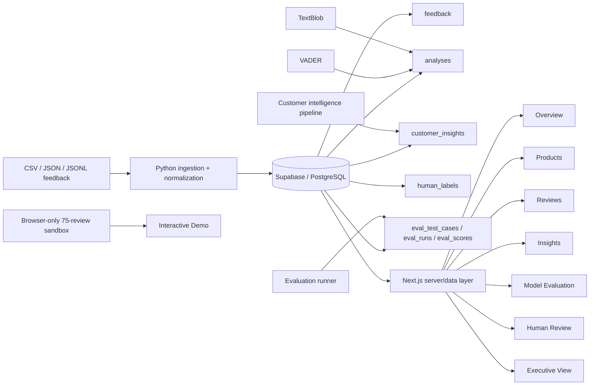

Responsibilities are deliberately separated: Python handles ETL/NLP/evals, Supabase stores normalized and derived data, Next.js renders the application and performs server-side aggregation, and Netlify hosts the web runtime.

---

# Security and deployment

Real secret files are excluded from Git:

```text
.env
web/.env.local
```

Template files are committed:

```text
.env.example
web/.env.local.example
```

The Supabase service-role credential remains server-side and should never use a `NEXT_PUBLIC_` prefix.

Production architecture:

```text
GitHub
   ↓
Netlify
   ↓
Next.js Runtime
   ↓
Supabase / PostgreSQL
```

Netlify configuration uses the `main` branch, `web` base directory, `npm run build`, and the Next.js runtime.

---

# Technology stack

### Frontend
- Next.js 15
- React
- TypeScript
- App Router
- custom CSS design system

### Data / backend
- Supabase
- PostgreSQL
- SQL migrations
- Supabase JavaScript client

### Analytics / NLP
- Python
- Pandas
- VADER
- TextBlob
- scikit-learn
- TF-IDF
- n-grams

### Evaluation
- custom 100-case suite
- 20 failure categories
- accuracy / precision / recall / macro F1
- latency / cost tracking
- human review
- regression-oriented comparison

### Deployment
- GitHub
- Netlify
- Supabase

---

# Repository structure

```text
Senvu-Customer-Intelligence-AI-Evals/
│
├── ai/
│   ├── evals/
│   ├── models/
│   ├── pipelines/
│   └── tests/
├── docs/
│   ├── BUILD_GUIDE.md
│   ├── CURRENT_STATE.md
│   ├── EVALS.md
│   ├── VALIDATION.md
│   └── screenshots/
├── legacy/
├── sample_data/
├── supabase/
│   ├── migrations/
│   └── seed.sql
├── web/
│   ├── app/
│   ├── components/
│   ├── lib/
│   ├── public/
│   ├── package.json
│   └── tsconfig.json
├── .env.example
├── .gitignore
├── requirements.txt
└── README.md
```

---

# Run locally

## Prerequisites

- Python 3.x
- Node.js
- npm
- Supabase project for database-backed functionality

## Clone

```bash
git clone https://github.com/Hamza102006/Senvu-Customer-Intelligence-AI-Evals.git
cd Senvu-Customer-Intelligence-AI-Evals
```

## Python setup — Windows

```powershell
python -m venv .venv
.\.venv\Scripts\Activate.ps1
pip install -r requirements.txt
```

## macOS/Linux

```bash
python -m venv .venv
source .venv/bin/activate
pip install -r requirements.txt
```

## Tests

```bash
python -m pytest -q
```

## Web setup

```bash
cd web
npm install
npm run dev
```

Open `http://localhost:3000/dashboard`.

## Production build

```bash
npm run build
```

The project has successfully completed a full Next.js production build.

---

# Engineering decisions

1. **Separate raw feedback from model output** so a review can be analyzed by more than one model.
2. **Separate human judgment from AI output** so corrections do not erase the prediction that caused them.
3. **Keep evaluation cases reusable** so models are compared on the same tests.
4. **Link intelligence to evidence** so recommendations are inspectable.
5. **Paginate database reads** so analytics do not silently stop at an API row limit.
6. **Isolate public demo state** so recruiters can interact without modifying shared data.
7. **Expose provenance** so measured and demo/preloaded output are not silently conflated.
8. **Keep a free-first core** so the project remains demonstrable without recurring API cost.

---

# Project evolution

The original project was roughly:

```text
CSV
 ↓
Python ETL
 ↓
VADER / TextBlob
 ↓
PostgreSQL
 ↓
Streamlit
```

Senvu expanded this into:

```text
MULTI-PRODUCT DATA
        ↓
NORMALIZED POSTGRESQL SCHEMA
        ↓
NLP ANALYSIS
        ↓
CUSTOMER INTELLIGENCE
        ↓
HUMAN LABELS
        ↓
EVALUATION SYSTEM
        ↓
NEXT.JS PRODUCT EXPERIENCE
        ↓
CLOUD DEPLOYMENT + PUBLIC SANDBOX
```

The legacy code remains in the repository to make that evolution visible.

### Legacy accuracy note

The original ETL project included an older **96% accuracy** result based on a manually labeled legacy set of **48 correct out of 50 reviews**. It should not be interpreted as VADER/TextBlob accuracy on the modern 100-case suite or the full 1,200-review corpus.

---

# Limitations and future work

Senvu is a portfolio-grade application rather than a fully multi-tenant commercial SaaS platform. Potential next steps include authentication, organization-level RLS, user roles, secure uploads, background analysis jobs, scheduled regression evaluations, semantic embeddings/clustering, live hosted transformer inference, optional live LLM analysis, larger labeled evaluation sets, audit logs and CI.

A known customer-intelligence improvement area is replacing overly generic TF-IDF terms with stronger semantic/domain clustering where appropriate.

---

# What this project demonstrates

### Software engineering
- full-stack architecture
- Next.js / React / TypeScript
- Python
- API routes
- production builds
- cloud deployment

### Data engineering
- ETL
- normalization
- relational schema design
- migrations
- pagination
- multi-product modeling

### NLP / AI
- sentiment analysis
- local baselines
- model adapters
- TF-IDF / n-grams
- structured model comparison

### AI evaluation
- reusable test cases
- failure-mode taxonomy
- classification metrics
- latency/cost awareness
- human review
- regression-oriented evaluation
- provenance

### Product thinking
- evidence → signal → action
- executive vs operational views
- portfolio comparison
- evidence-backed recommendations
- human correction workflows
- recruiter-safe sandboxing
- data-quality transparency

---

# Authors)

**Talaha Khan**  

---

<div align="center">

## Senvu

**Customer Intelligence & AI Evals**

Understand what customers are saying.  
Measure whether the AI interpreting them deserves to be trusted.

</div>

